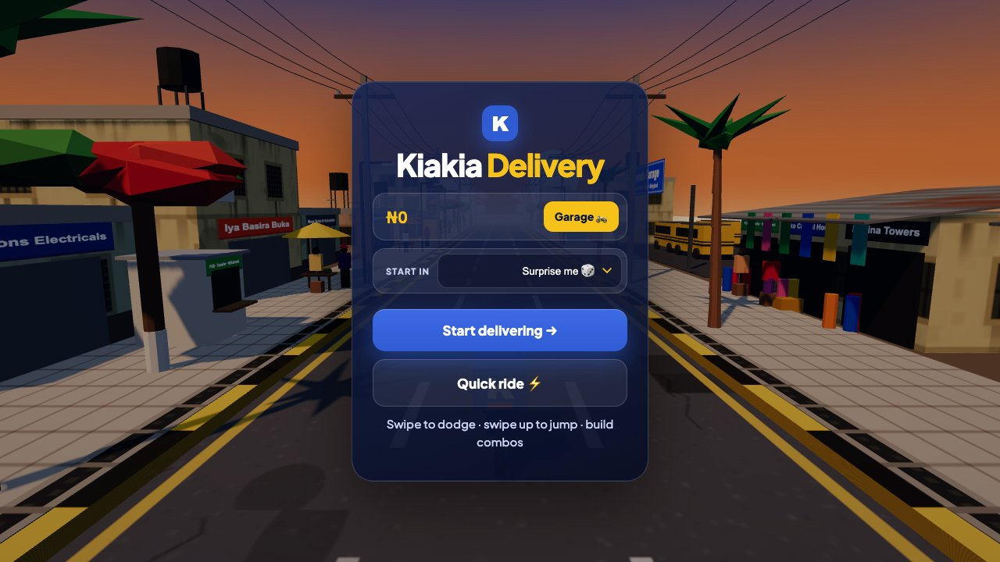
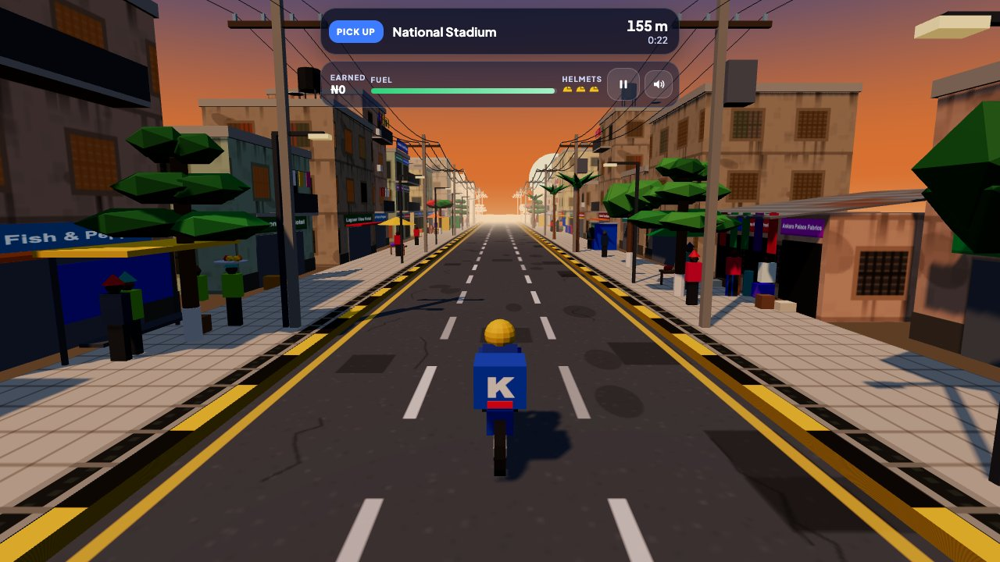

# Kiakia Delivery

A 3D browser game: ride a Kiakia delivery bike through Lagos traffic, from Lekki to Badagry.

**Play it:** [kiakia-dash.vercel.app](https://kiakia-dash.vercel.app) (phone, tablet or computer)

 

- **21 real Lagos areas**, from Lekki Phase 1 and Victoria Island to Agege, Ketu, Apapa and Badagry, each with its own buildings, traffic, delivery places and a landmark you ride past: the National Stadium, the Oshodi Interchange, Mile 12 Market, the UNILAG gate, the Apapa port cranes, the Point of No Return and more.
- **Start anywhere:** pick the area you start in, or let the game surprise you.
- **Junctions:** a green sign shows the next area. Swipe the way it points at the junction to turn; miss it and you ride on until the next one.
- **₦ coins** on the road (and bonuses for turns and deliveries) buy bikes and rider outfits in the **Garage**.
- **Power-ups:** the Go-slow buster (faster, slip through traffic) and the Parcel magnet (pulls coins and parcels to you).
- **Two modes:** a Delivery shift (real jobs, timer, fuel, ratings, 88% of the fare) and an Arcade dash.
- **Plays offline** once loaded, and can be added to the home screen. Fits phones, tablets and computers, in any orientation.
- **Controls:** arrow keys or A / D; swipe or tap left / right on a phone.
- **Built with:** TypeScript, [Three.js](https://threejs.org) and Vite. Every model is made from simple shapes in code and the sounds are generated with the Web Audio API.

```bash
npm install
npm run dev     # local development
npm run build   # production build in dist/
```

Same-day delivery in Lagos: [kiakia-ng.vercel.app](https://kiakia-ng.vercel.app)

---

© 2026 Isabella Zainab Zachary. All rights reserved. The code is public to read; it is not licensed for reuse. Kiakia and its logo are the author's brand.
